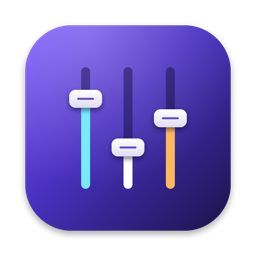

<p align="center">
  
</p>

<h1 align="center">Fader</h1>

<p align="center">Per app volume control in the macOS menu bar.</p>

Fader adjusts the volume (0% to 150%) and mute state of each app in real time. It relies only on the native Core Audio Process Tap API (`AudioHardwareCreateProcessTap`): no virtual driver, no external dependencies and no network connections.

## Requirements

* macOS 15.0 or later
* Apple Silicon Mac (arm64)

## Install

1. Download the latest `Fader-<version>.dmg` from the [Releases](../../releases) page.
2. Open the DMG and drag `Fader.app` into the Applications folder.
3. Open Fader. It lives only in the menu bar, with no Dock icon.
4. The first time you move a slider, macOS asks for the system audio capture permission. Accept it: without it the controlled app goes silent.

Releases from 1.0.2 onward are signed with a Developer ID and notarized by Apple, so they open without a Gatekeeper warning.

## Usage

* Click the sliders icon in the menu bar.
* The header shows the current output device, the master volume and the master mute.
* Every app with an open audio session gets a row with mute, slider and percentage. The waveform icon marks apps that are playing right now.
* The slider goes up to 150%. It snaps to 100% with haptic feedback.
* "Reset All" sets every app back to 100% and removes the taps.
* Volume and mute are remembered per app across launches.
* "Launch at Login" registers the app as a login item.

## How it works

* For each app whose volume is not 100% (or that is muted), Fader creates a private Process Tap with `muteBehavior = .mutedWhenTapped`, which silences the original stream and hands the audio to Fader.
* A private aggregate device combines the tap with the default output device. An `AudioDeviceIOProc` copies the tapped audio to the output while applying the gain.
* The audio callback does not allocate memory, take locks or touch Swift or Objective C objects. Gain and mute arrive through atomics (`Synchronization.Atomic`).
* The volume curve is quadratic up to 100% and linear from 100% to 150%. Above 100% a `tanhf` soft clipper kicks in. Gain is interpolated sample by sample to avoid clicks.
* Helper processes (Chrome, Electron, WebKit) are grouped under their parent app, so each app shows up once.
* At 100% and unmuted there is no tap at all: the app audio passes through untouched.

## Build

Requires Xcode (Swift 6).

```bash
./build_app.sh           # builds build/Fader.app, ad hoc signed
./package_dmg.sh         # builds build/Fader-<version>.dmg
swift test               # audio processing tests
./scripts/make_icon.sh   # regenerates Resources/Fader.icns
```

### Signed and notarized builds

By default the app is signed ad hoc, which is enough to run on the machine that built it. To produce a DMG that opens on other Macs without a Gatekeeper warning, sign with a Developer ID Application identity and notarize:

```bash
xcrun notarytool store-credentials fader-notary --apple-id <apple id> --team-id <team id>
SIGN_IDENTITY="<Developer ID Application identity>" NOTARY_PROFILE=fader-notary ./package_dmg.sh
```

An ad hoc build copied to another Mac is blocked on first launch. Allow it once with `xattr -dr com.apple.quarantine /Applications/Fader.app`.

## Known limitations

* The first adjustment of an app takes 1.5 to 2 seconds to take effect, which is the time macOS spends initializing the aggregate device. The same applies when the output device changes.
* Without the audio capture permission, an app with a changed volume goes silent. "Reset All" undoes it.
* Apps at 100% and unmuted are not tapped.

## Diagnostics

```bash
/usr/bin/log show --last 5m --predicate 'subsystem == "com.local.fader"'
```
