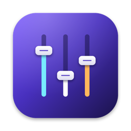
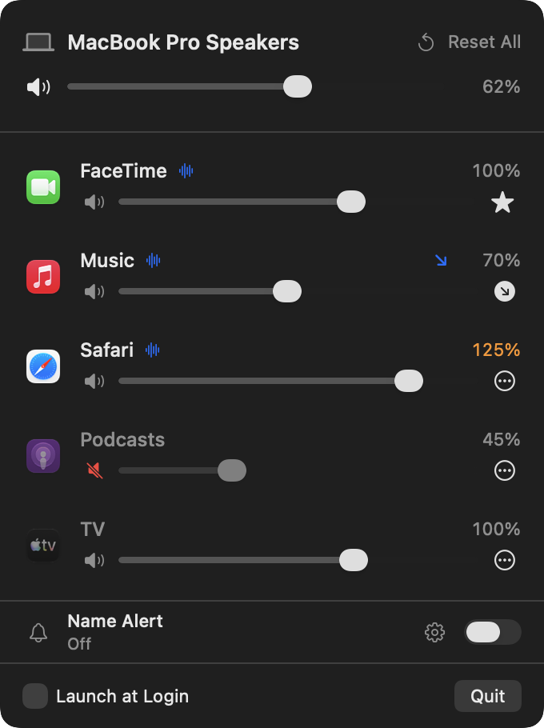

<p align="center">
  
</p>

<h1 align="center">Calando</h1>

<p align="center">Per app volume control in the macOS menu bar, with automatic ducking.</p>

<p align="center">
  <a href="../../releases/latest">Download</a> ·
  <a href="https://github.com/sponsors/rdanieli">Sponsor</a>
</p>

<p align="center">
  
</p>

Calando adjusts the volume (0% to 150%) and mute state of each app in real time, and can lower your music automatically while a call is playing. It relies only on the native Core Audio Process Tap API (`AudioHardwareCreateProcessTap`): no virtual driver, no external dependencies and no network connections.

## Features

* **Per app volume and mute**, from 0% up to 150%, with a snap and haptic tick at 100%.
* **Automatic ducking.** Mark an app as priority (a star) and others as "lower while a priority app plays". While the priority app is producing audio, the others fade down to 10%, 20%, 30% or 50% and fade back when it stops.
* **Name Alert (optional, macOS 26 or newer).** While a starred app plays muted or quiet, Calando notices when someone says your name, notifies you and can bring the volume back on its own.
* **Nothing installed in the system.** No audio driver, no kernel or system extension, no helper daemon.
* **Private by construction.** Zero network code. Audio never leaves the render callback, unless you turn on Name Alert: then the audio of the app being listened to is transcribed on this Mac by the system speech model, and nothing is recorded or stored.
* **Notarized by Apple**, signed with a Developer ID.
* **Small.** A single 1.3 MB download.
* Remembers volume, mute and ducking role per app. Follows the default output device when you plug in headphones.

## Requirements

* macOS 15.0 or later (Name Alert needs macOS 26.0 or later)
* Apple Silicon Mac (arm64)

## Install

With Homebrew:

```bash
brew tap rdanieli/tap
brew install --cask rdanieli/tap/calando
```

Recent Homebrew versions refuse casks from third party taps until you trust them. If the install is refused, run `brew trust rdanieli/tap` and repeat it.

Or manually:

1. Download the latest `Calando-<version>.dmg` from the [Releases](../../releases/latest) page.
2. Open the DMG and drag `Calando.app` into the Applications folder.

Then open Calando. It lives only in the menu bar, with no Dock icon. The first time it takes control of an app, macOS asks for the System Audio Recording permission. Accept it: without it the controlled apps go silent, and Calando shows a warning with a shortcut to the right settings pane.

## Usage

* Click the sliders icon in the menu bar.
* The header shows the current output device, the master volume and the master mute.
* Every app with an open audio session gets a row. Apps that are playing right now are listed first and marked with a waveform.
* Drag a slider to set the volume of that app. Click the speaker to mute it.
* Click the button at the end of a row to pick its ducking role and the lowered volume.
* "Reset All" sets every app back to 100%.
* "Launch at Login" registers the app as a login item.

### Ducking example

Mark your meeting app as **Priority** and your music player as **Lower this while a priority app plays**. When the call starts, the music drops to 30% within a quarter of a second. About a second and a half after the call goes quiet, the music fades back.

### Name Alert

Lower or mute a call while you do something else, and let Calando watch for your name.

* Mark the meeting app as **Priority** (the star).
* Open the gear on the Name Alert row, turn it on and type your name and nicknames, separated by commas. Pick the language spoken in your calls.
* The first time, macOS asks for Speech Recognition and notification permissions, and Calando downloads the on-device speech model for that language.
* Name Alert listens only while a starred app is playing and is muted or below 50%, or while the output is muted. In any other situation nothing is transcribed.
* When your name is heard you get a notification. With "Raise the volume automatically" on, the app is unmuted right away, set back to 100% if it was below 50%, and the output is unmuted.
* "Not Me" on the alert undoes the volume change. If the word that fired was a variation, it is removed from your list.

Speech recognizers often write a name differently from how it is spelled ("Danieli" comes out as "Daniel"). **Find Variations** speaks your names with the system voices, runs them through the recognizer and lists the words it wrote instead. Tick the ones you want treated as your name. Common words and other people's names cause false alerts, so nothing is ticked for you.

## How it works

* For each app that needs control, Calando creates a private Process Tap with `muteBehavior = .mutedWhenTapped`, which silences the original stream and hands the audio to Calando.
* A private aggregate device combines the tap with the default output device. An `AudioDeviceIOProc` copies the tapped audio to the output while applying the gain.
* The audio callback does not allocate memory, take locks or touch Swift or Objective C objects. Gain, mute and fade speed arrive through atomics (`Synchronization.Atomic`).
* The volume curve is quadratic up to 100% and linear from 100% to 150%. Above 100% a `tanhf` soft clipper kicks in. Gain moves toward its target sample by sample at a bounded rate, so neither slider drags nor ducking fades click.
* When Name Alert is listening to an app, the callback also writes a mono copy of the untouched input into a preallocated ring buffer, wait free. A background task drains it into the system `SpeechAnalyzer`, and the transcript is matched against your names as whole words.
* Helper processes (Chrome, Electron, WebKit) are grouped under their parent app, so each app shows up once.
* An app at 100%, unmuted and with no ducking role is not tapped at all: its audio passes through untouched.
* Starting a tap takes macOS a moment. Once audio capture is known to work, Calando starts the taps of playing apps when you open the popover, so the first slider drag responds immediately. Idle taps are released shortly after the popover closes.

## Build

Requires Xcode (Swift 6).

```bash
./build_app.sh           # builds build/Calando.app, ad hoc signed
./package_dmg.sh         # builds build/Calando-<version>.dmg
swift test               # audio processing and ducking policy tests
./scripts/make_icon.sh   # regenerates Resources/Calando.icns
```

`CALANDO_SCREENSHOT_PATH=docs/screenshot.png swift test` regenerates the screenshot above from demo data.

### Signed and notarized builds

By default the app is signed ad hoc, which is enough to run on the machine that built it. To produce a DMG that opens on other Macs without a Gatekeeper warning, sign with a Developer ID Application identity and notarize:

```bash
xcrun notarytool store-credentials calando-notary --apple-id <apple id> --team-id <team id>
SIGN_IDENTITY="<Developer ID Application identity>" NOTARY_PROFILE=calando-notary ./package_dmg.sh
```

An ad hoc build copied to another Mac is blocked on first launch. Allow it once with `xattr -dr com.apple.quarantine /Applications/Calando.app`.

## Known limitations

* Apple Silicon and macOS 15 or later only.
* When an app is tapped for the first time without the popover open (for example right after launch, or when the output device changes), macOS can take up to two seconds to hand over its audio. The app keeps playing at its original volume during that time.
* Ducking reacts to an app holding an audio output stream, not to speech. A meeting app counts as playing for the whole call.
* Name Alert depends on the system speech recognizer. Full first names are recognized well, short nicknames and surnames often are not, and an alert arrives roughly a second after the name is spoken. It only hears other people, through the app audio: it does not listen to your microphone.
* Without the System Audio Recording permission, controlled apps go silent. "Reset All" releases them.

## Diagnostics

```bash
/usr/bin/log show --last 5m --predicate 'subsystem == "io.github.rdanieli.calando"'
```

## Support

Calando is free and open source. If it saves you from reaching for the volume keys in every meeting, you can support its development through [GitHub Sponsors](https://github.com/sponsors/rdanieli).

## License

MIT. See [LICENSE](LICENSE).
